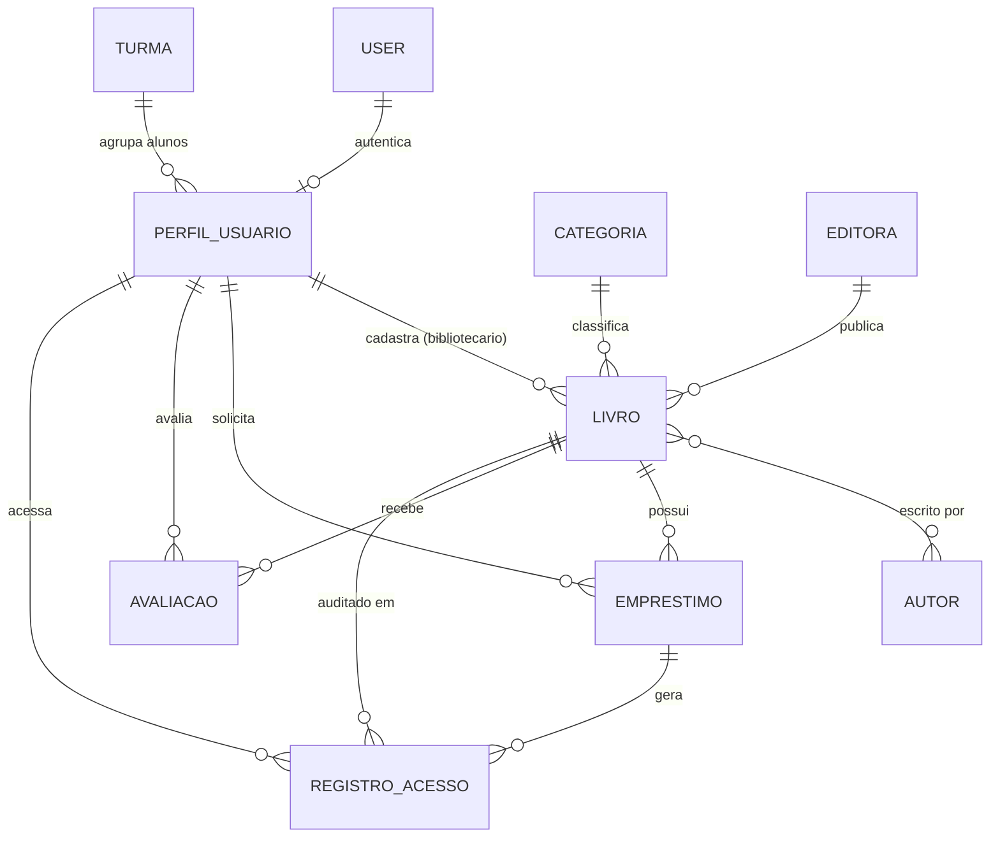
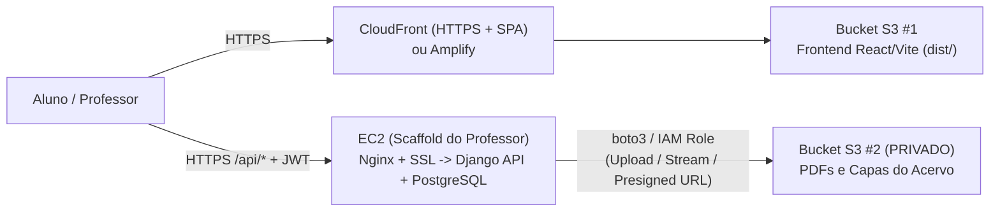

# Plano Técnico e Backlog de Tasks — Backend Django (Arandu - Saber Digital)

> **Projeto:** Arandu - Saber Digital — Biblioteca Virtual Escolar em PDF  
> **Instituição:** Colégio Estadual de Tempo Integral Paulo José de Oliveira  
> **Escopo deste plano:** Exclusivamente camada **Django / PostgreSQL / API REST** (`core/`, `apps/`, `requirements.txt`).  
> **Regra de infraestrutura:** **NÃO modificar** `ssl/`, `nginx/`, `proxy/`, `infra/` nem `docker-compose.yml`.

---

## 1. Decisões Fechadas de Arquitetura

1. **Base aproveitada do PR #1 (`apps/arandu`)**:
   - `Livro.categoria` permanece como **`ForeignKey`** (1 categoria principal por livro, mantendo `LivroInline` direto no Admin).
   - `PerfilUsuario.tipo` permanece com **`ALUNO`** e **`BIBLIOTECARIO`** (o bibliotecário/gestor atua como administrador escolar na plataforma — separado do superusuário do `/admin/`).
   - `PerfilUsuario` continua vinculado ao `User` padrão do Django via `OneToOneField` (compatível com `django-allauth` já configurado no scaffold).
2. **Modularização (requisito: ≥ 2 apps Django)**:
   - **`apps/contas`** *(novo app)*: `Turma`, `PerfilUsuario`, autenticação JWT, recuperação de senha, envio de e-mails e gestão de alunos.
   - **`apps/arandu`** *(app existente)*: `Categoria`, `Autor`, `Editora`, `Livro`, `Emprestimo`, `Avaliacao`, `RegistroAcesso`, serviços ACID, leitura/download protegido de PDF e integração com API externa (ISBN).
3. **Total de modelos (requisito: 7 a 10 modelos)**: **9 modelos** de domínio (além das tabelas nativas do Django/allauth).
4. **Regra de Direitos Autorais (PDF único)**:
   - Toda obra aceita apenas formato **PDF** (validado por extensão + *magic bytes* `%PDF-` + tamanho máximo de 25 MB).
   - **`dominio_publico = True`**: com empréstimo `ATIVO`, o aluno pode **Ler na Plataforma** (`/ler/`) e **Baixar o PDF** (`/download/`).
   - **`dominio_publico = False`**: download **bloqueado** (`403 Forbidden`); com empréstimo `ATIVO`, o aluno só pode **Ler na Plataforma** (`/ler/`).
5. **Rotas sem mexer no Nginx**: todas as rotas da API ficam montadas sob `/api/...` em `core/urls.py`, funcionando tanto em `http://localhost:8080/api/...` quanto em `https://projetosd.local/api/...`.

---

## 2. Alertas Técnicos Obrigatórios (Leia antes de codar!)

### 2.1 Versões compatíveis com `Django==3.2.11` + `Python 3.11.3`
O `Dockerfile` usa Python 3.11 e `requirements.txt` fixa `Django==3.2.11`. **NÃO instale libs sem travar versão**, pois versões mais novas derrubaram suporte ao Django 3.2. Use estes pins:

```txt
djangorestframework==3.14.0
djangorestframework-simplejwt==5.2.2
django-cors-headers==4.3.1
django-filter==23.5
drf-spectacular==0.27.2
Faker==24.14.0
```
*(Após atualizar `requirements.txt`, rodar `docker compose build web` uma única vez.)*

### 2.2 Segurança dos PDFs (`private_media/` vs `media/`)
- **NUNCA** servir `livros/pdfs/` como mídia pública em `urls.py`, senão qualquer pessoa com a URL direta burla login, empréstimo e a regra de `dominio_publico=False`.
- **Capas** ficam em `MEDIA_ROOT/capas/` (públicas).
- **PDFs** ficam em `FileSystemStorage(location=BASE_DIR / 'private_media')` (privado) e **nunca** têm `.url` exposta nos serializers DRF.
- Os arquivos PDF são entregues exclusivamente via `FileResponse` nas views `/api/livros/<uuid>/ler/` (`inline`, `Cache-Control: private, no-store`, `X-Content-Type-Options: nosniff`) e `/api/livros/<uuid>/download/` (`attachment`).
- **Nota para o Frontend React**: `<iframe>` não envia header `Authorization: Bearer <token>`. O leitor no React (`pdfjs-dist`) deve buscar `/ler/` via `fetch`/`axios` com `responseType: 'arraybuffer'` e renderizar em `<canvas>`.
- Adicionar `media/` e `private_media/` no `.gitignore`.

### 2.3 Bugs silenciosos já existentes em `core/settings.py` para corrigir na Fase 1
1. **E-mail sobrescrito**: `core/settings.py` (linhas 46–53) sobrescreve `EMAIL_HOST_USER`/`EMAIL_HOST_PASSWORD` com `'xxxxxxxxxx'` depois de importar `conf/development` e `conf/production`. Em `dev`, manter `console.EmailBackend` (os links de reset aparecem direto no `docker logs web`); em `prod`, ler das env vars e `readSecret('EMAIL_HOST_PASSWORD_FILE')`.
2. **Falta `LocaleMiddleware`**: adicionar `django.middleware.locale.LocaleMiddleware` entre `SessionMiddleware` e `CommonMiddleware` para o header `Accept-Language: pt-br | en` funcionar.
3. **Ordem do `CorsMiddleware`**: colocar `corsheaders.middleware.CorsMiddleware` **antes** de `CommonMiddleware` (ideal centralizar `MIDDLEWARE` em `core/settings.py` para `dev` e `prod` não divergirem).

### 2.4 ACID, Transações e Concorrência (PostgreSQL + Django)
- **Lock ordenado contra deadlock**: em operações que tocam estoque e empréstimo (`solicitar`, `devolver`), travar **sempre na mesma ordem**: `Livro` primeiro (`select_for_update()`), `Emprestimo` depois.
- **Atualização atômica de estoque**: usar `F('quantidade_disponivel') - 1` / `+ 1` dentro de `@transaction.atomic`, respaldado pela `CheckConstraint(quantidade_disponivel <= quantidade_total)` do PostgreSQL.
- **Idempotência na devolução**: se `emprestimo.status == 'DEVOLVIDO'`, retornar sem incrementar o estoque novamente (evita duplicação em duplo clique).
- **E-mails seguros (`transaction.on_commit`)**: todo envio de e-mail (boas-vindas, empréstimo, devolução) deve rodar dentro de `transaction.on_commit(...)` para nunca disparar em caso de rollback.
- **Sincronização de `User` e `PerfilUsuario`**: toda criação/edição/desativação de aluno passa por `apps/contas/services.py` dentro de `transaction.atomic()`, mantendo `User.email/is_active` e `PerfilUsuario.email/ativo` sempre consistentes.
- **Transição automática para `ATRASADO`**: helper `sincronizar_atrasos()` executando um único `UPDATE` indexado (`status='ATIVO' AND data_prevista_devolucao < CURRENT_DATE`), chamado antes das listagens/ações de empréstimo e via comando `atualizar_atrasos`.

---

## 3. Modelagem Final do Banco (9 Modelos)



| # | App | Modelo | Principais campos e regras |
|---|---|---|---|
| 1 | `contas` | **`Turma`** | `id` (UUID), `nome` (ex.: `1º Ano A`), `turno` (`MANHA`/`TARDE`/`INTEGRAL`), `ano_letivo`, `ativa`. Unique em `(nome, ano_letivo)`. |
| 2 | `contas` | **`PerfilUsuario`** | `id` (UUID), `user` (`OneToOne(User)`), `nome`, `email` (unique), `matricula` (unique, validada), `tipo` (`ALUNO` / `BIBLIOTECARIO`), `turma` (`FK(Turma, null=True)`), `telefone`, `ativo`, `precisa_trocar_senha`. |
| 3 | `arandu` | **`Categoria`** | `id` (UUID), `nome` (unique), `slug` (unique automático), `descricao`, `criado_em`. |
| 4 | `arandu` | **`Autor`** | `id` (UUID), `nome` (db_index), `nacionalidade` (opcional), `biografia` (opcional). |
| 5 | `arandu` | **`Editora`** | `id` (UUID), `nome` (unique), `cidade` (opcional), `site` (opcional). |
| 6 | `arandu` | **`Livro`** | `id` (UUID), `titulo`, `autores` (`M2M(Autor)`), `editora` (`FK(Editora, null=True)`), `categoria` (`FK(Categoria, PROTECT)`), `isbn` (`blank=True, null=True, unique=True` — converte `""` para `None`), `ano_publicacao`, `sinopse`, `capa` (mídia pública), `arquivo_pdf` (`private_storage`, validador `.pdf` + magic bytes + 25 MB), `quantidade_total` (`>= 1`), `quantidade_disponivel`, `dominio_publico` (bool), `ativo` (bool), `cadastrado_por` (`FK(PerfilUsuario, SET_NULL, null=True)`). Constraints: `disponivel <= total` e `total >= 1`. |
| 7 | `arandu` | **`Emprestimo`** | `id` (UUID), `usuario` (`FK(PerfilUsuario, PROTECT)`), `livro` (`FK(Livro, PROTECT)`), `data_emprestimo`, `data_prevista_devolucao`, `data_devolucao`, `status` (`ATIVO`/`DEVOLVIDO`/`ATRASADO`), `renovacoes`, `observacoes`. Constraint: `UniqueConstraint` condicional para empréstimo aberto (`ATIVO`/`ATRASADO`) por `(usuario, livro)`. |
| 8 | `arandu` | **`Avaliacao`** | `id` (UUID), `usuario` (`FK(PerfilUsuario, CASCADE)`), `livro` (`FK(Livro, CASCADE)`), `nota` (`1..5`), `comentario` (opcional), `criado_em`. Constraint: 1 avaliação por `(usuario, livro)`. |
| 9 | `arandu` | **`RegistroAcesso`** | `id` (UUID), `usuario` (`FK(PerfilUsuario, SET_NULL, null=True)`), `livro` (`FK(Livro, CASCADE)`), `emprestimo` (`FK(Emprestimo, SET_NULL, null=True)`), `tipo` (`LEITURA`/`DOWNLOAD`), `ip` (opcional), `acessado_em`. |

---

## 4. Contrato da API REST

### Envelope padrão de paginação (`AranduPagination`)
Todas as listagens usam `page_size=12` (ajustável via `?page_size=`, máximo `50`):

```json
{
  "count": 48,
  "total_pages": 4,
  "current_page": 1,
  "next": "http://localhost:8080/api/livros/?page=2",
  "previous": null,
  "results": []
}
```

### Mapa de Endpoints

| Módulo | Método e Rota | Permissão | Descrição |
|---|---|---|---|
| **Auth** | `POST /api/auth/login/` | Público (throttled) | Login por `identificador` (e-mail ou matrícula) + `password` → JWT (`access`, `refresh`) + dados do perfil |
| **Auth** | `POST /api/auth/refresh/` | Público | Renova token JWT |
| **Auth** | `GET /api/auth/me/` | Autenticado | Dados do usuário, perfil, turma e resumo de empréstimos |
| **Auth** | `POST /api/auth/esqueci-senha/` | Público (throttled) | Envia e-mail HTML (`humanize`) com `uid` + `token`; retorna sempre `200` |
| **Auth** | `POST /api/auth/redefinir-senha/` | Público | Valida `uid`/`token` e aplica nova senha |
| **Catálogo** | `GET /api/livros/` | Autenticado | Paginado; busca (`titulo`/`autores`/`isbn`), filtros (`categoria`, `dominio_publico`, `disponivel`); retorna `nota_media` e status do empréstimo do usuário |
| **Catálogo** | `GET /api/livros/<uuid>/` | Autenticado | Detalhes completos + `pode_ler` + `pode_baixar` + empréstimo ativo do aluno |
| **Catálogo** | `GET/POST /api/livros/<uuid>/avaliacoes/` | Autenticado | Lista paginada e criação/edição de avaliação (nota `1..5`) |
| **Auxiliares** | `GET/POST /api/categorias/`, `/autores/`, `/editoras/` | GET: Autenticado / POST: Bibliotecário | Alimenta filtros e "+ Nova categoria" no upload |
| **PDF** | `GET /api/livros/<uuid>/ler/` | Empréstimo `ATIVO` ou Bibliotecário | Streaming `inline` de `private_media/` + registra `RegistroAcesso(LEITURA)` |
| **PDF** | `GET /api/livros/<uuid>/download/` | Empréstimo `ATIVO` + `dominio_publico=True` | `403` se `dominio_publico=False`; registra `RegistroAcesso(DOWNLOAD)` |
| **Empréstimos** | `GET /api/emprestimos/meus/` | Autenticado | Paginado, filtro `status` (`ATIVO`/`ATRASADO`/`DEVOLVIDO`) |
| **Empréstimos** | `POST /api/emprestimos/` | Autenticado | Transação ACID (`select_for_update` + `F()` + `on_commit`) |
| **Empréstimos** | `POST /api/emprestimos/<uuid>/devolver/` | Dono ou Bibliotecário | Transação ACID idempotente |
| **Empréstimos** | `POST /api/emprestimos/<uuid>/renovar/` | Dono | Até 2 renovações, se não atrasado |
| **Gestão** | `GET /api/gestao/resumo/` | Bibliotecário | Métricas agregadas: `total_obras`, `emprestimos_ativos`, `em_atraso`, `total_leituras` |
| **Gestão** | `GET/POST/PATCH /api/gestao/livros/` | Bibliotecário | CRUD + upload `multipart/form-data` (PDF + capa) + ativar/ocultar |
| **Gestão** | `GET /api/gestao/livros/buscar-isbn/<isbn>/` | Bibliotecário | Consome **Open Library API** (fallback **Google Books API**) com timeout de 5s |
| **Gestão** | `GET/POST/PATCH /api/gestao/alunos/` | Bibliotecário | Paginado; busca nome/matrícula/turma; cria `User` + `PerfilUsuario` atomicamente |
| **Gestão** | `GET/POST /api/gestao/turmas/` | Bibliotecário | CRUD simples de turmas |
| **Gestão** | `GET /api/gestao/emprestimos/` | Bibliotecário | Paginado; busca aluno/matrícula/livro + filtro `status` |
| **Público** | `GET /api/publico/acervo/` | Público | API aberta para outros sistemas/grupos + uso de sessão anônima (`request.session`) |
| **Docs** | `GET /api/docs/` e `/api/schema/` | Público | Documentação Swagger UI (`drf-spectacular`) |

---

## 5. Backlog Detalhado em Tasks

> **Status Atual do Repositório (LEIA ANTES DE CODAR / USAR IA):**
> - **Épico 1 (`T1.1` e `T1.2`) — ✅ CONCLUÍDO E VALIDADO NO DOCKER + POSTGRESQL:** Dependências pinadas em `requirements.txt`, `core/settings.py` (DRF, JWT, `AranduPagination`, CORS, `LocaleMiddleware`, e-mail dev/prod, `PRIVATE_MEDIA_ROOT`, `/api/schema/` e `/api/docs/`), app `apps/contas` (`Turma`, `PerfilUsuario`, `validators.py`), app `apps/arandu` (`Categoria`, `Autor`, `Editora`, `Livro`, `Emprestimo`, `Avaliacao`, `RegistroAcesso`, `storage.py`, `validators.py`) e migrações iniciais (`contas/0001_initial.py` e `arandu/0001_initial.py`) **já estão implementados e testados no container `web` + PostgreSQL**.
> - **Correções de DX incluídas:** `init-services-projetosd-web.sh` normalizado para LF com `.gitattributes` (`*.sh text eol=lf`) e `manage.py` sem travar em `debugpy.wait_for_client()` (ativável via `DEBUGPY_WAIT_FOR_CLIENT=1`).
> - **NÃO recrie** esses arquivos, modelos ou migrações iniciais. Comece a partir dos **Épicos 2, 3, 4 ou 5** usando a estrutura já pronta.
> - **Ao subir o Docker localmente após puxar este commit (dentro de `backend/Arandu`):** rode `docker compose build web && docker compose up -d projetosd_db web && docker exec web python manage.py migrate`.

### Épico 1 — Fundação *(✅ CONCLUÍDO — desbloqueia o restante do time)*

#### T1.1 — Dependências, Settings, CORS, Paginação e Docs — ✅ CONCLUÍDA
- **Branch:** `feat/setup-api-base` *(integrada)*
- **Arquivos:** `requirements.txt`, `core/settings.py`, `core/conf/development/settings.py`, `core/conf/production/settings.py`, `core/urls.py`, `core/pagination.py`, `.gitignore`, `.gitattributes`, `init-services-projetosd-web.sh`, `manage.py`
- **Escopo:**
  - [x] Adicionar dependências pinadas para Django 3.2 em `requirements.txt`.
  - [x] Centralizar `MIDDLEWARE` com `CorsMiddleware` antes de `CommonMiddleware` e `LocaleMiddleware` após `SessionMiddleware`.
  - [x] Corrigir configuração de e-mail em `core/settings.py` (console em `dev`; env/secret em `prod`).
  - [x] Configurar `REST_FRAMEWORK` (JWT, `AranduPagination`, `django-filter`, `ScopedRateThrottle`, `drf-spectacular`).
  - [x] Configurar `PRIVATE_MEDIA_ROOT`, servir `MEDIA_URL` apenas em `DEBUG` (somente capas) e adicionar `media/` e `private_media/` no `.gitignore`.
  - [x] Expor `/api/schema/` e `/api/docs/` em `core/urls.py`.
- **Critério de aceite:** `docker compose build web && docker compose up -d projetosd_db web` validado sem erros; `http://localhost:8080/api/docs/` e `/api/schema/` respondendo `200` com Swagger UI e CORS ativo.

#### T1.2 — Multi-App (`apps/contas` + `apps/arandu`), 9 Modelos e Validadores — ✅ CONCLUÍDA
- **Branch:** `feat/modelos-completos` *(integrada)*
- **Arquivos:** `apps/contas/{apps.py,models.py,validators.py,admin.py,migrations/0001_initial.py}`, `apps/arandu/{models.py,storage.py,validators.py,admin.py,migrations/0001_initial.py}`, `core/settings.py`
- **Escopo:**
  - [x] Criar e registrar app `apps.contas` com `Turma` e `PerfilUsuario` (mantendo `ALUNO`/`BIBLIOTECARIO`, vinculando `turma` via FK e adicionando `precisa_trocar_senha`).
  - [x] Evoluir `apps/arandu/models.py` mantendo `Livro.categoria` como FK e adicionando `Autor`, `Editora`, `Avaliacao`, `RegistroAcesso`, `Livro.autores` (M2M), `Livro.editora` (FK), `Livro.ativo`, `Livro.cadastrado_por`, `Livro.isbn` opcional (convertendo `""` → `None`) e `private_storage` no `arquivo_pdf`.
  - [x] Implementar validadores em `validators.py`: ISBN-10/13, extensão `.pdf` + magic bytes `%PDF-`, tamanho máximo 25 MB, matrícula e nota `1..5`.
  - [x] Gerar e rodar `makemigrations` + `migrate` limpo nos dois apps no PostgreSQL.
- **Critério de aceite:** `docker exec web python manage.py check` passa sem erros e todas as 9 tabelas + constraints (`unique_turma_nome_ano_letivo`, `livro_disponivel_nao_excede_total`, `livro_quantidade_total_minimo_1`, `unique_emprestimo_aberto_por_usuario_livro`, `unique_avaliacao_por_usuario_livro`, `avaliacao_nota_entre_1_e_5`) existem no PostgreSQL.

---

### Épico 2 — Autenticação, Recuperação de Senha, E-mail e Alunos (`apps/contas`)

#### T2.1 — Login JWT (E-mail ou Matrícula) e Permissões
- **Branch:** `feat/contas-auth-jwt`
- **Arquivos:** `apps/contas/{serializers.py,views.py,permissions.py,urls.py}`
- **Escopo:**
  - [ ] Implementar `POST /api/auth/login/` aceitando e-mail ou matrícula + senha, checando `user.is_active` **e** `perfil.ativo`.
  - [ ] Implementar `POST /api/auth/refresh/` e `GET /api/auth/me/`.
  - [ ] Criar permissões `IsBibliotecario` e `IsUsuarioAtivo`.
- **Critério de aceite:** Login funciona com matrícula e com e-mail; conta inativa recebe `401/403`; aluno recebe `403` em `/api/gestao/*`.

#### T2.2 — Recuperação de Senha + E-mails HTML com `humanize`
- **Branch:** `feat/contas-reset-senha`
- **Arquivos:** `apps/contas/{emails.py,views.py,serializers.py}`, `apps/templates/emails/{reset_senha.html,boas_vindas_aluno.html,confirmacao_emprestimo.html}`
- **Escopo:**
  - [ ] Implementar `POST /api/auth/esqueci-senha/` (throttled, resposta sempre `200`, gera `uid` + `token` com `default_token_generator`).
  - [ ] Implementar `POST /api/auth/redefinir-senha/` validando token + `AUTH_PASSWORD_VALIDATORS`.
  - [ ] Criar templates HTML de e-mail usando ``.
- **Critério de aceite:** Fluxo completo funciona em dev via `console.EmailBackend` e rejeita token expirado ou reutilizado.

#### T2.3 — Gestão Transacional de Alunos e Turmas (Exclusivo Bibliotecário)
- **Branch:** `feat/contas-gestao-alunos`
- **Arquivos:** `apps/contas/{services.py,serializers.py,views.py,urls.py}`
- **Escopo:**
  - [ ] Criar `services.py` para cadastrar/editar/desativar aluno sincronizando `User` + `PerfilUsuario` dentro de `transaction.atomic()`.
  - [ ] Se senha inicial não for enviada no `POST`, gerar senha temporária segura, retorná-la uma única vez no `201` e agendar e-mail via `transaction.on_commit()`.
  - [ ] Expor `GET/POST/PATCH /api/gestao/alunos/` (paginado + busca por nome/matrícula/turma) e `GET/POST /api/gestao/turmas/`.
- **Critério de aceite:** Desativar aluno via `PATCH` bloqueia o login imediatamente; criação gera e-mail apenas após commit confirmado.

---

### Épico 3 — Catálogo, Upload de PDF, API Externa ISBN e Avaliações (`apps/arandu`)

#### T3.1 — Catálogo Paginado, Filtros, Detalhes e Avaliações
- **Branch:** `feat/arandu-catalogo`
- **Arquivos:** `apps/arandu/{serializers.py,filters.py,views.py,urls.py}`
- **Escopo:**
  - [ ] Implementar `GET /api/livros/` e `GET /api/livros/<uuid>/` com `select_related`, `prefetch_related` e `annotate(nota_media, total_avaliacoes)` (sem N+1).
  - [ ] Suportar busca (`titulo`, `autores__nome`, `isbn`) e filtros (`categoria`, `dominio_publico`, `disponivel`).
  - [ ] Implementar `GET/POST /api/livros/<uuid>/avaliacoes/` (paginado, 1 avaliação por aluno/livro) e endpoints `/api/categorias/`, `/autores/`, `/editoras/`.
- **Critério de aceite:** Listagem paginada responde no envelope padrão, sem expor URL direta de PDF.

#### T3.2 — Gestão do Acervo, Upload de PDF e Resumo
- **Branch:** `feat/arandu-gestao-livros`
- **Arquivos:** `apps/arandu/{serializers.py,views.py}`
- **Escopo:**
  - [ ] Implementar `GET/POST/PATCH /api/gestao/livros/` (`multipart/form-data`, permissão `IsBibliotecario`) preenchendo `cadastrado_por` automaticamente.
  - [ ] Implementar `GET /api/gestao/resumo/` em 1 consulta agregada (`total_obras`, `emprestimos_ativos`, `em_atraso`, `total_leituras`).
- **Critério de aceite:** Upload rejeita arquivo `.txt` renomeado para `.pdf` (magic bytes), aceita PDF válido em `private_media/` e permite ativar/ocultar obra via `PATCH`.

#### T3.3 — Integração com API Externa por ISBN *(Requisito Desejável)*
- **Branch:** `feat/arandu-busca-isbn`
- **Arquivos:** `apps/arandu/{integrations.py,views.py}`
- **Escopo:**
  - [ ] Implementar `GET /api/gestao/livros/buscar-isbn/<isbn>/` consultando Open Library API com fallback para Google Books API (`timeout=5s`).
  - [ ] Normalizar resposta JSON (`titulo`, `autores`, `editora`, `ano_publicacao`, `sinopse`, `capa_url`) e tratar erros de rede/404 sem erro 500.
- **Critério de aceite:** ISBN real retorna dados preenchidos; ISBN inválido retorna `400` e não encontrado retorna `404`.

---

### Épico 4 — Empréstimos ACID, PDF Protegido, API Pública e i18n (`apps/arandu`)

#### T4.1 — Serviço Transacional ACID de Empréstimos
- **Branch:** `feat/arandu-emprestimos-acid`
- **Arquivos:** `apps/arandu/{services.py,serializers.py,views.py,management/commands/atualizar_atrasos.py}`
- **Escopo:**
  - [ ] Implementar `solicitar_emprestimo`, `devolver_emprestimo`, `renovar_emprestimo` e `sincronizar_atrasos` em `services.py` com `@transaction.atomic`, lock ordenado (`Livro` → `Emprestimo`), `F()`, idempotência e `transaction.on_commit()`.
  - [ ] Expor `/api/emprestimos/meus/`, `POST /api/emprestimos/`, `/devolver/`, `/renovar/` e `GET /api/gestao/emprestimos/`.
  - [ ] Criar management command `python manage.py atualizar_atrasos`.
- **Critério de aceite:** Dois pedidos para livro com 1 exemplar só permitem 1 empréstimo; devolução dupla não ultrapassa `quantidade_total`; aluno com atraso não pode pegar novos livros.

#### T4.2 — Endpoints Protegidos `/ler/` vs `/download/`
- **Branch:** `feat/arandu-pdf-protegido`
- **Arquivos:** `apps/arandu/views.py`
- **Escopo:**
  - [ ] `GET /api/livros/<uuid>/ler/`: exige empréstimo `ATIVO` válido (ou `IsBibliotecario`), grava `RegistroAcesso(LEITURA)` e retorna `FileResponse` `inline` com `Cache-Control: private, no-store` e `X-Content-Type-Options: nosniff`.
  - [ ] `GET /api/livros/<uuid>/download/`: exige empréstimo `ATIVO` válido **E** `dominio_publico=True` (caso contrário `403`), grava `RegistroAcesso(DOWNLOAD)` e retorna `FileResponse(..., as_attachment=True)`.
- **Critério de aceite:** Obra com `dominio_publico=False` permite `200` em `/ler/` e retorna `403` em `/download/`.

#### T4.3 — API Pública, Sessão Anônima, i18n e Comprovante Django *(Desejáveis + Requisitos Django)*
- **Branch:** `feat/arandu-publico-i18n`
- **Arquivos:** `apps/arandu/views.py`, `apps/templates/arandu/comprovante_emprestimo.html`, `locale/`
- **Escopo:**
  - [ ] Expor `GET /api/publico/acervo/` (público, paginado, grava últimas buscas em `request.session`).
  - [ ] Marcar mensagens de erro/validação da API com `gettext_lazy` e compilar traduções `pt-br` / `en` (ativadas via `Accept-Language`).
  - [ ] Criar rota simples de comprovante de empréstimo renderizado via Django Template usando `django.contrib.humanize`.
- **Critério de aceite:** `Accept-Language: en` retorna erros traduzidos em inglês; `/api/publico/acervo/` responde sem autenticação e registra sessão anônima.

---

### Épico 5 — Admin Customizado, Faker e Testes

#### T5.1 — Django Admin Avançado (`fieldsets`, `inlines`, `messages`)
- **Branch:** `feat/admin-customizado`
- **Arquivos:** `apps/contas/admin.py`, `apps/arandu/admin.py`
- **Escopo:**
  - [ ] Registrar todos os **9 modelos** com `fieldsets` organizados, `TabularInline`, `list_display`, `list_filter`, `search_fields` e `autocomplete_fields`.
  - [ ] Criar actions customizadas (ex.: *"Marcar empréstimos selecionados como devolvidos"* chamando `devolver_emprestimo` ACID e exibindo feedback via `django.contrib.messages`).
- **Critério de aceite:** Todos os 9 modelos gerenciáveis em `/admin/` preservando integridade de estoque.

#### T5.2 — Comando Faker (`python manage.py popular_banco`)
- **Branch:** `feat/comando-faker`
- **Arquivos:** `apps/arandu/management/commands/popular_banco.py`
- **Escopo:**
  - [ ] Criar comando idempotente (com flag `--limpar`) gerando dados realistas em `pt_BR`: turmas, 2 bibliotecários, 30 alunos, categorias, autores, editoras, 25+ livros (misturando `dominio_publico=True/False` + PDF mínimo válido salvo em `private_media/` para testar o leitor), empréstimos nos 3 status e avaliações.
- **Critério de aceite:** Rodar `docker exec web python manage.py popular_banco` deixa o sistema pronto para testes e apresentação.

#### T5.3 — Suíte de Testes Automatizados (`APITestCase`)
- **Branch:** `feat/testes-api`
- **Arquivos:** `apps/contas/tests.py`, `apps/arandu/tests.py`
- **Escopo:**
  - [ ] Testar login por e-mail/matrícula, reset de senha, permissões Aluno vs Bibliotecário.
  - [ ] Testar transação ACID de empréstimo/devolução/renovação, validação de magic bytes `%PDF-`, regra `dominio_publico` (`200` vs `403`), paginação e `i18n`.
- **Critério de aceite:** `docker exec web python manage.py test` passa 100%.

---

## 6. Sugestão de Divisão da Equipe (4 Integrantes)

| Integrante | Trilha | Tasks |
|---|---|---|
| **Integrante 1 (Líder)** | Fundação + Empréstimos ACID + PDF protegido + Revisão de PRs | `T1.1`, `T4.1`, `T4.2` |
| **Integrante 2** | 9 Modelos + Validadores + Django Admin Avançado + Faker | `T1.2`, `T5.1`, `T5.2` |
| **Integrante 3** | App `apps/contas` (JWT, Reset de Senha + E-mails, CRUD Alunos/Turmas) | `T2.1`, `T2.2`, `T2.3` |
| **Integrante 4** | Catálogo + Upload PDF + API Externa ISBN + Avaliações + API Pública/i18n/Testes | `T3.1`, `T3.2`, `T3.3`, `T4.3`, `T5.3` |

### Fluxo de Sprints
1. **Sprint 1 (Base — sequencial):** Merge de `T1.1` + `T1.2` na `main`. Todos fazem `git pull` a partir daqui.
2. **Sprint 2 (Paralelo):** Os 4 integrantes trabalham simultaneamente em suas branches de feature (`T2.*`, `T3.*`, `T4.*`, `T5.1`/`T5.2`).
3. **Sprint 3 (Qualidade e Integração):** `T5.3` (testes), integração com o frontend React/Vite e validação final do checklist do professor.

---

## 7. Topologia de Deploy na AWS (Produção)



### Boas práticas para o deploy na AWS
1. **Dois buckets S3 separados**:
   - **Bucket 1 (Frontend)**: recebe o build estático (`dist/`) do React + Vite.
   - **Bucket 2 (Acervo/PDFs)**: configurado com **Block all public access** ativado (100% privado), impedindo download direto pela URL do S3 e garantindo que a regra de empréstimo `ATIVO` e `dominio_publico` continue sendo aplicada pela API Django.
2. **HTTPS e SPA no Frontend (CloudFront ou Amplify)**:
   - O S3 Static Website puro serve apenas em HTTP e devolve `404` em recarregamentos de rotas do React Router. Colocar **CloudFront** na frente do bucket do frontend (ou usar Amplify) garante HTTPS e fallback `403/404 → /index.html (200)`.
3. **API + PostgreSQL na EC2**:
   - Mantém integralmente o scaffold Docker do professor (`postgres`, `pgadmin`, `web`, `proxy`, `ssl`) e os scripts `infra/pg` de backup/restore.
   - **Atenção à RAM**: em instâncias `t2.micro`/`t3.micro` (1 GB RAM), criar **2 GB de swap** no Linux antes de rodar `docker compose build` (ou usar `t3.small` com 2 GB RAM).
4. **Migração transparente de disco local → S3 no Django**:
   - Com o storage abstraído em `apps/arandu/storage.py`, em dev salvamos em `private_media/`/`media/` no disco; em produção na EC2 plugamos `django-storages` + `boto3` (preferencialmente via **IAM Role** da EC2, sem chaves AWS em código/repo), sem alterar `models.py` nem os serviços ACID.

---

## 8. Checklist Final — Requisitos do Professor

- [x] Grupo com 3 ou 4 integrantes (4 integrantes)
- [x] Mínimo de 7 a 10 modelos (**9 modelos** implementados no Épico 1)
- [x] Mínimo de 2 aplicações Django (`apps.contas` + `apps.arandu` no Épico 1)
- [ ] Customização do Admin (`fieldsets`, `inlines`, `actions`) *(registro base pronto; customização avançada na T5.1)*
- [ ] Autenticação + Recuperação de senha + Envio de e-mail
- [x] Validação de dados (`validators.py`: ISBN, magic bytes PDF, tamanho, matrícula, nota — Épico 1)
- [ ] Banco de dados PostgreSQL + transações ACID *(modelos/constraints prontos; transações ACID na T2.3 e T4.1)*
- [ ] Humanização (`django.contrib.humanize` nos e-mails e comprovante)
- [ ] Framework de Mensagens (`django.contrib.messages` no Admin e views Django)
- [x] Paginação (`AranduPagination` configurada em `core/pagination.py` — Épico 1)
- [ ] *(Desejável)* Consumir API REST externa (Open Library / Google Books por ISBN)
- [ ] *(Desejável)* Fornecer API para consumo externo (`/api/publico/acervo/` + `/api/docs/` — `/api/docs/` já pronto)
- [ ] *(Desejável)* Internacionalização (`pt-br` / `en`) *(`LocaleMiddleware` e `LANGUAGES` prontos; traduções na T4.3)*
- [ ] *(Desejável)* Sessões anônimas (`request.session` em `/api/publico/acervo/`)
